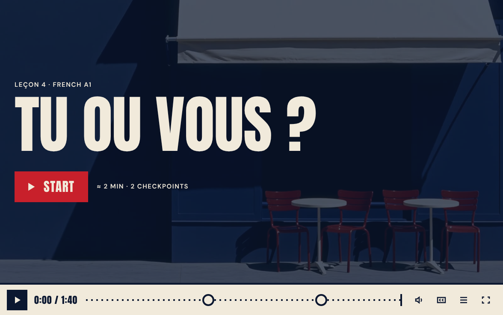
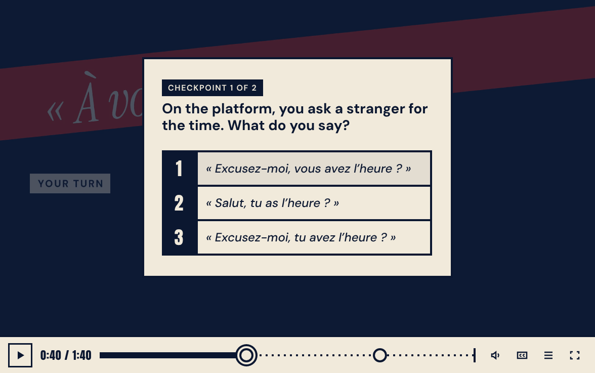
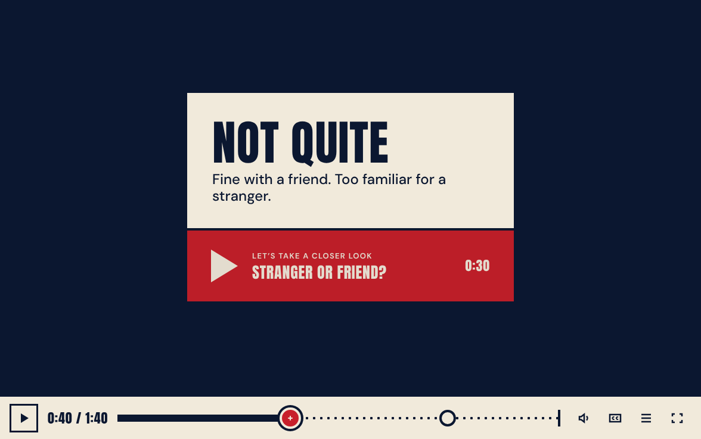
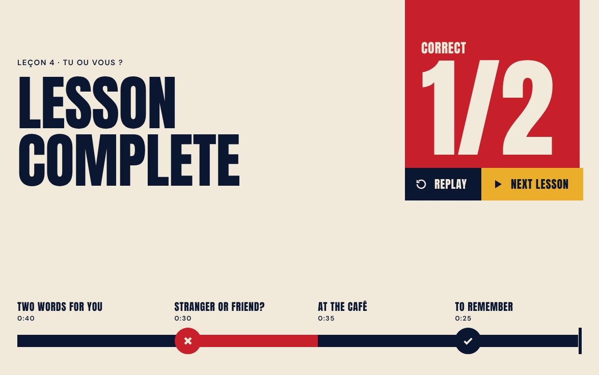

# Fork — a branching skin for Video.js v10

**Fork** is a [Video.js v10](https://videojs.org) skin for lessons that branch on what the viewer answers. The video stops at a checkpoint. A right answer carries on; a wrong one takes a short detour, *a closer look*, and then rejoins the lesson. The timeline is a map of the route the viewer actually took.

**Live demo:** [peredelskiy.github.io/frenchili](https://peredelskiy.github.io/frenchili/) — two French A1 lessons at Frenchili, a fictional language school, streaming from Mux.



| Checkpoint | Route card after a wrong answer |
| --- | --- |
|  |  |



## Why it is built this way

- **One video, many routes.** Every part of a lesson, detours included, lives in one media file. A scenario JSON says where each part starts and ends and which answer leads where. Branching is a seek, so there is no source switching, and one Mux playback ID carries the whole lesson.
- **The timeline is a map.** Parts are stretches of line, checkpoints are stations, detours appear once taken. It is still a real slider: scrub and use the arrow keys within the part of the lesson you have unlocked; checkpoints can’t be skipped.
- **The transition is designed, not hidden.** After an answer a card gives the verdict, one line of why, and where the route goes next. It waits for the viewer: click, Enter or Space continues.
- **The skin doesn’t know the lesson.** Swap the JSON and the video and it is a different course. Every word on screen comes from the scenario’s `labels`, and every colour, size and font is a `--fork-*` custom property.
- **Accessible by default.** The checkpoint is a modal dialog with a radio group, digits pick an answer, focus moves for keyboard users only, every state is announced, and axe-core runs clean in every state at desktop and phone sizes. Reduced motion is honoured.
- **Works on a phone.** At narrow widths the controls fold into a menu, tap targets are 44 px, and on iPhone (no element fullscreen) the skin falls back to a fixed full-screen layer so checkpoints still work in fullscreen.

## Use it on a page (Webflow, an LMS, plain HTML)

Load the stylesheet and one script, then wrap your video:

```html
<link rel="stylesheet" href="https://cdn.jsdelivr.net/gh/Peredelskiy/frenchili@main/dist-lib/fork.css" />
<script type="module" src="https://cdn.jsdelivr.net/gh/Peredelskiy/frenchili@main/dist-lib/fork-mux.js"></script>

<video-player>
  <fork-skin scenario-src="/lessons/tu-ou-vous.json"
             poster="https://image.mux.com/PLAYBACK_ID/thumbnail.webp?time=78">
    <mux-video playback-id="PLAYBACK_ID" playsinline preload="metadata" crossorigin="anonymous"></mux-video>
  </fork-skin>
</video-player>
```

- `fork-mux.js` includes Video.js’s `<mux-video>` element. For a plain file or your own HLS, load `fork.js` instead and use `<video src="…">`.
- The skin is set in Anton and DM Sans. Load them from Google Fonts, or point `--fork-font-display` and `--fork-font-text` at your site’s fonts.
- In Webflow, put the two tags in the page’s custom code and the player markup in an Embed element. Host the scenario JSON anywhere that serves JSON with CORS (a CMS file field, a gist, the same CDN), or inline it: `<script type="application/json">{ … }</script>` as a child of `<fork-skin>`.
- Add `viewport-fit=cover` to the page’s viewport meta so fullscreen on iPhone fills the screen.
- A runnable example without any build step: [`examples/embed.html`](examples/embed.html).

### `<fork-skin>` attributes

| Attribute | Effect |
| --- | --- |
| `scenario-src` | URL of the scenario JSON. |
| `poster` | Image for the start screen. |
| `autostart` | Skip the start screen; the lesson begins on the first play. |
| `auto-continue` | Milliseconds after which the route card continues by itself (by default it waits for the viewer). |
| `reduced-motion` | Force reduced motion (the system setting is honoured regardless). |

### Events

All bubble from the skin.

| Event | `detail` |
| --- | --- |
| `fork-answer` | `{ questionId, optionId, correct }` |
| `fork-complete` | `{ route, answers }` — the hook for an LMS or analytics. |
| `fork-change` | The full route state on every change. |
| `fork-error` | `{ message }` when the scenario can’t be loaded or is invalid. |

## Scenario format

```json
{
  "version": 1,
  "kicker": "Leçon 4 · French A1",
  "title": "Tu ou vous ?",
  "name": "Leçon 4 · Tu ou vous ?",
  "start": "p1",
  "nextLesson": { "title": "Leçon 5 · Bonjour ou salut ?", "href": "./?lesson=5" },
  "labels": { "closerLook": "Let’s take a closer look", "complete": "Lesson complete" },
  "nodes": {
    "p1": { "type": "segment", "kind": "main", "title": "Two words for you", "in": 0, "out": 40, "next": "q1" },
    "q1": {
      "type": "question",
      "title": "Checkpoint 1 of 2",
      "prompt": "On the platform, you ask a stranger for the time. What do you say?",
      "options": [
        { "id": "a", "label": "« Excusez-moi, vous avez l’heure ? »", "correct": true, "next": "p1a", "feedback": "A stranger, so vous — and avez goes with it." },
        { "id": "b", "label": "« Salut, tu as l’heure ? »", "next": "p1b", "feedback": "Fine with a friend. Too familiar for a stranger." }
      ]
    },
    "p1a": { "type": "segment", "kind": "confirm", "title": "Exactly", "in": 40, "out": 48, "next": "p2" },
    "p1b": { "type": "segment", "kind": "detour", "title": "Stranger or friend?", "in": 48, "out": 78, "next": "p2" },
    "p2": { "type": "segment", "kind": "main", "title": "At the café", "in": 78, "out": 113, "next": "complete" }
  }
}
```

(A shortened version of lesson 4: the real one has a second checkpoint and a closing part.)

- `kind`: `main` is the lesson line; `confirm` is a short part after a right answer; `detour` is the closer look after a wrong one. Both rejoin at `next`.
- `in` and `out` are seconds in the media file. Parts can sit anywhere in the file; the skin seeks when the next part isn’t contiguous.
- `next: "complete"` ends the lesson. `nextLesson` adds a Next lesson button to the final screen.
- `labels` overrides any on-screen word (the full list is `ScenarioLabels` in [`src/fork/scenario.ts`](src/fork/scenario.ts)), so a lesson can be in any language.
- The scenario is validated on load; the first problem is reported as a readable error.

The real scenarios for the demo are [`public/tu-ou-vous.json`](public/tu-ou-vous.json) and [`public/bonjour-ou-salut.json`](public/bonjour-ou-salut.json).

## Keyboard

| Key | Action |
| --- | --- |
| Space, K | Play / pause; continue from a route card |
| ← → | ±5 s (also on the focused timeline) |
| J, L | ±10 s |
| ↑ ↓ | Volume; move between answers at a checkpoint |
| 1–9 | Pick an answer |
| Enter | Confirm the answer; continue from a route card |
| PageUp / PageDown, Home / End | Previous / next part, start / end of the part (timeline focused) |
| B | Back to the lesson from a closer look |
| M, C, F | Mute, captions, fullscreen |
| Esc | Leave fullscreen; close a menu |

## Components

Every piece is a light-DOM custom element built on Video.js’s `UIElement`, so it renders inside the player, follows fullscreen and user activity, and can be rearranged in your own layout. `forkSkinTemplate()` is the reference layout.

| Element | Role |
| --- | --- |
| `fork-scenario` | The engine, no UI: loads the scenario, pauses at checkpoints, seeks between parts, keeps the route. |
| `fork-route-map` | The timeline as a route map (compact in the bar, expanded on the final screen). |
| `fork-question` | The checkpoint dialog. |
| `fork-route-card` | The card between an answer and the next part, and the “back to the lesson” toast. |
| `fork-detour-badge` | “A closer look · back to the lesson in 0:29” and the skip button. |
| `fork-start`, `fork-complete` | The start and final screens. |
| `fork-skin` | Lays it all out around the media element with the Video.js controls, hotkeys, announcer and error dialog. |

## Develop

```bash
npm install
npm run dev          # demo at http://127.0.0.1:5173
npm run typecheck
npm run build:site   # the live demo (streams from Mux) → dist-site/
npm run build:lib    # fork.js, fork-mux.js, fork.css → dist-lib/
```

On localhost the demo plays local files from `public/media/` (not in the repo); add `?media=mux` to stream from Mux instead. The browser tests in `scripts/` (end-to-end routes, axe-core audit in every state, the design guideline checks, iPhone fullscreen) drive headless Chrome against those local files.

Built for the [Contra × Mux Video.js v10 skins challenge](https://contra.com). Design and code by Collabas.

## License

[Apache-2.0](LICENSE)
